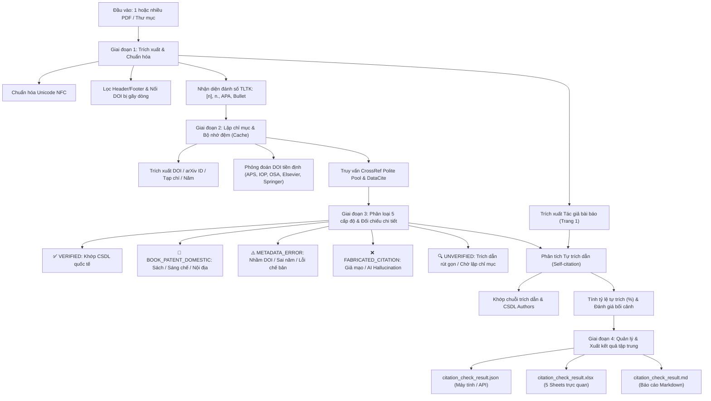

# PDF Citation Audit & Verification Skill (`pdf-citation-audit`)

[](https://www.python.org/)
[](LICENSE)
[](https://www.crossref.org/)
[](SKILL.md)

**PDF Citation Audit** là bộ công cụ và kỹ năng mở rộng (Skill) dành cho trợ lý AI Google Antigravity, biên tập viên tạp chí, hội đồng khoa học và các nhà nghiên cứu. Công cụ tự động trích xuất, đối chiếu chéo và kiểm định tính trung thực của danh mục tài liệu tham khảo trực tiếp từ các bản thảo khoa học dạng PDF qua các cơ sở dữ liệu học thuật quốc tế (CrossRef, DataCite, arXiv, Europe PMC).

---

## 🌟 Điểm nổi bật (Key Features)

- 🔍 **Phát hiện Trích dẫn Giả mạo do AI tạo sinh (AI Hallucination):** Tự động nhận diện các bài báo bị ChatGPT / LLM bịa đặt tiêu đề, tự gán mã DOI giả (`404 Not Found`) hoặc **chiếm đoạt mã DOI** của một công trình có thật hoàn toàn khác.
- ⚠️ **Phát hiện Sai lệch Metadata & Lỗi chế bản:** Chỉ ra các trường hợp bài báo thật nhưng tác giả dán nhầm DOI, gõ thừa số 0, ghi sai năm xuất bản, hoặc dán lẫn văn bản thân bài/nhãn đồ thị vào mục tài liệu tham khảo.
- 🔄 **Phân tích Tự trích dẫn của Tác giả (Author Self-citation):** Trích xuất tự động tên tác giả từ Trang 1 PDF, so khớp đa biến thể tên người Việt và quốc tế, tính toán tỷ lệ tự trích (`self_citation_rate`) và phân loại bối cảnh (*Báo cáo tổng kết nhóm nghiên cứu 10–20 năm* vs *Trích dẫn cục bộ quá mức*).
- 📂 **Đầu vào linh hoạt (Multi-input):** Hỗ trợ kiểm tra **1 tệp PDF lẻ**, **danh sách nhiều tệp PDF**, hoặc **quét hàng loạt cả thư mục** chứa hàng chục đến hàng trăm bản thảo.
- 📊 **Quản lý kết quả tập trung (Consolidated Outputs):** Không phân mảnh thư mục; kết xuất đồng bộ vào 2 tệp duy nhất:
  - `citation_check_result.json`: Dữ liệu phân tầng máy đọc được dành cho hệ thống tự động hóa và API.
  - `citation_check_result.xlsx`: Sổ tay Excel 5 trang tính (worksheets) chuyên nghiệp với màu sắc trực quan, AutoFilter và Freeze Panes phục vụ phản biện và ban biên tập.
- ⚡ **Bộ nhớ đệm bền vững & CrossRef Polite Pool:** Cơ chế `api_cache.json` lưu giữ 100% kết quả tra cứu, kiểm tra lại toàn bộ hàng nghìn tài liệu chỉ trong vài giây mà không lo nghẽn Rate Limit.

---

## 🏛️ Kiến trúc quy trình (Architecture)



---

## 🚀 Cài đặt (Installation)

### Cách 1: Cài đặt làm Skill cho Google Antigravity / AI Agent

Chỉ cần clone repository này vào thư mục cấu hình Skill của Antigravity:

```bash
# Cài đặt toàn cục (Global Skill - áp dụng cho mọi workspace):
git clone https://github.com/minhdoan00/pdf-citation-audit.git ~/.gemini/config/skills/pdf-citation-audit

# Hoặc cài đặt riêng cho một workspace dự án cụ thể:
git clone https://github.com/minhdoan00/pdf-citation-audit.git .gemini/skills/pdf-citation-audit
```

Cài đặt các thư viện phụ thuộc:
```bash
pip install -r ~/.gemini/config/skills/pdf-citation-audit/requirements.txt
```

### Cách 2: Sử dụng độc lập bằng Python CLI

```bash
git clone https://github.com/minhdoan00/pdf-citation-audit.git
cd pdf-citation-audit
pip install -r requirements.txt
```

---

## 💻 Hướng dẫn sử dụng (Usage)

### 1. Quét toàn bộ thư mục chứa các bản thảo PDF
```bash
python -X utf8 scripts/batch_audit.py "duong_dan_thu_muc_chua_pdf" --email "your_email@domain.edu.vn"
```

### 2. Quét một bản thảo PDF duy nhất
```bash
python -X utf8 scripts/batch_audit.py "path/to/manuscript.pdf" --email "your_email@domain.edu.vn"
```

### 3. Quét nhiều bản thảo PDF cụ thể
```bash
python -X utf8 scripts/batch_audit.py "paper1.pdf" "paper2.pdf" "paper3.pdf" -o "output_dir"
```

### Các tham số dòng lệnh tùy chọn:
- `--email <email>`: Email kích hoạt hàng đợi ưu tiên tốc độ cao CrossRef Polite Pool (mặc định: `academic_audit@vnu.edu.vn`).
- `--output-dir` / `-o`: Thư mục lưu kết quả xuất ra (mặc định cùng thư mục với đầu vào).
- `--output-prefix`: Tên tiền tố tệp xuất (mặc định: `citation_check_result`).
- `--cache-file`: Đường dẫn tệp bộ nhớ đệm `api_cache.json`.
- `--workers`: Số luồng xử lý đồng thời (mặc định: `16`).
- `--create-folders`: Bật tùy chọn tạo các thư mục `Report_<filename>` riêng lẻ cho từng bài (mặc định: `False` - quản lý tập trung).

---

## 📊 Cấu trúc tệp Excel xuất ra (`citation_check_result.xlsx`)

Tệp Excel được thiết kế tối ưu với 5 trang tính:

| Trang tính (Sheet) | Mục đích | Nội dung chính |
| :--- | :--- | :--- |
| **1. Tổng quan & Thống kê** | Dashboard tổng thể | Thống kê số lượng bản thảo, tổng TLTK, tỷ lệ tự trích dẫn tổng thể, bảng phân loại 5 trạng thái CSDL và chuẩn mực đánh giá. |
| **2. Danh sách Bản thảo** | Quản lý danh mục bài | Bảng tổng hợp từng bản thảo: tác giả, tổng số TLTK, tỷ lệ tự trích, số bài xác thực, số lỗi metadata, số ca giả mạo AI và đánh giá sơ bộ. |
| **3. Chi tiết Toàn bộ TLTK** | Bảng dữ liệu phẳng | Toàn bộ các trích dẫn từ tất cả các bài; đầy đủ trích dẫn gốc, đánh dấu tự trích, mã DOI chuẩn, trạng thái và chi tiết đối chiếu CSDL. |
| **4. Cảnh báo & Lỗi cần xử lý** | Dành riêng cho Ban biên tập | Bộ lọc riêng các ca **Giả mạo trích dẫn (AI)** và **Lỗi Metadata / Nhầm DOI** kèm chi tiết lỗi để gửi phản hồi cho tác giả. |
| **5. Phân tích Tự trích dẫn** | Rà soát minh bạch học thuật | Danh mục các trích dẫn tự trích của các tác giả giúp đánh giá mức độ tương quan học thuật. |

---

## 📑 Bảng chuẩn mực đánh giá Tự trích dẫn

| Mức độ tự trích | Tỷ lệ (%) | Ý nghĩa học thuật & Khuyến nghị phản biện |
| :---: | :---: | :--- |
| 🟢 **Bình thường** | $\le 25\%$ | Kế thừa tự nhiên các nghiên cứu nền tảng trước đây; phù hợp thông lệ quốc tế. |
| ⚠️ **Đáng chú ý** | $25\% - 50\%$ | Cần xem xét sự cân bằng giữa việc trích dẫn bài của bản thân và việc bao quát tài liệu quốc tế độc lập. |
| 🔄 **Báo cáo tổng kết nhóm** | $> 50\%$ (đến $100\%$) | Thường gặp ở các **Báo cáo tổng kết 10–20 năm xây dựng và phát triển nhóm nghiên cứu / phòng thí nghiệm (Retrospective Review)**. Trong bối cảnh này, việc tập trung trích dẫn các công bố của chính nhóm là **hoàn toàn tự nhiên, hợp lệ và mang giá trị ghi chép lịch sử khoa học**. |

---

## 📁 Cấu trúc thư mục mã nguồn

```
pdf-citation-audit/
├── SKILL.md                 # Đặc tả Antigravity Skill
├── README.md                # Tài liệu hướng dẫn sử dụng
├── requirements.txt         # Thư viện phụ thuộc Python
├── LICENSE                  # Giấy phép phần mềm MIT
├── .gitignore               # Tệp loại trừ cho Git
└── scripts/
    ├── batch_audit.py       # Bộ điều phối trung tâm (CLI Runner)
    ├── extract_references.py # Trích xuất TLTK & Tác giả từ PDF
    ├── verifier.py          # Bộ máy đối chiếu API CSDL quốc tế & Tự trích dẫn
    └── excel_reporter.py    # Bộ máy xuất báo cáo Excel 5 Sheets chuẩn hóa
```

---

## 📄 Bản quyền (License)

Phát hành theo [Giấy phép MIT](LICENSE). Bản quyền (c) 2026 Minh Doan.
Mọi đóng góp, báo lỗi (Issues) và yêu cầu kéo (Pull Requests) đều được hoan nghênh!
