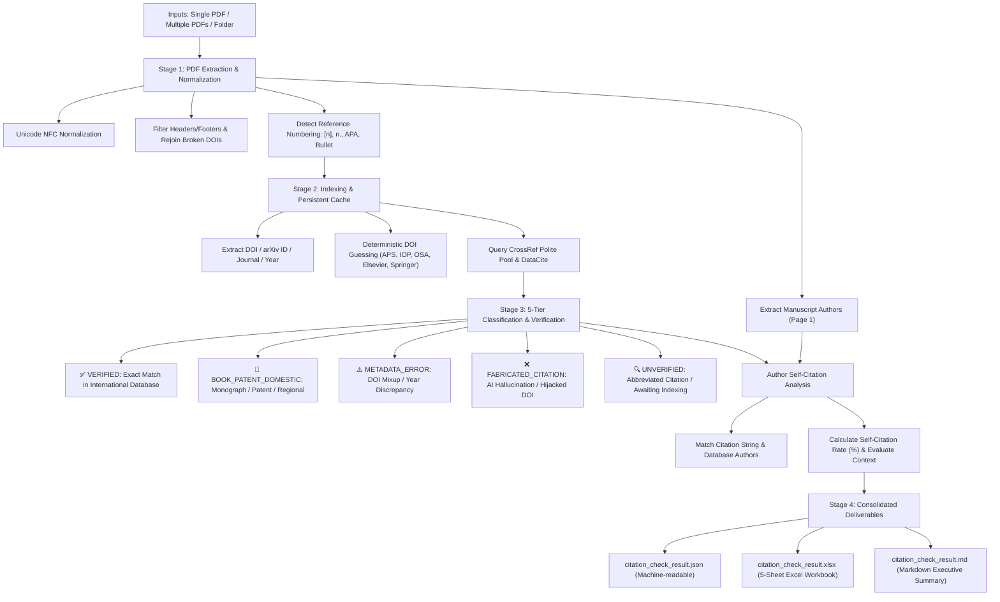

# PDF Citation Audit & Verification Toolkit (`pdf-citation-audit`)

[](https://www.python.org/)
[](LICENSE)
[](https://www.crossref.org/)
[](SKILL.md)

**PDF Citation Audit** is an automated scholarly toolkit and custom skill for AI coding assistants (such as Google Antigravity), journal editors, program committees, and researchers. It automatically extracts, cross-references, and validates the authenticity of reference lists directly from scientific PDF manuscripts against major scholarly databases (**CrossRef**, **DataCite**, **arXiv**, and **Europe PMC**).

---

## 🌟 Key Features

- 🔍 **AI Hallucination & Fake Citation Detection:** Automatically detects non-existent papers generated by LLMs (e.g., ChatGPT), fake (`404 Not Found`) DOIs, and **hijacked DOIs** (genuine DOIs assigned to completely unrelated paper titles).
- ⚠️ **Metadata & Publishing Error Diagnosis:** Pinpoints authentic papers misattributed due to copy-paste errors, trailing zeroes in DOIs, publication year discrepancies, or body text mistakenly pasted into the bibliography.
- 🔄 **Author Self-Citation Analysis:** Automatically extracts manuscript authors from Page 1 of the PDF, builds multi-variant name matchers (diacritics, reversed names, abbreviated initials), computes self-citation counts and rates (`self_citation_rate`), and contextualizes **10–20 year retrospective laboratory reviews** versus isolated research articles.
- 📂 **Multi-Input Versatility:** Audit a **single PDF file**, a **list of explicit PDF files**, or **recursively scan an entire directory** of manuscripts.
- 📊 **Consolidated Dual Deliverables:** Eliminates cluttered subfolders; aggregates all audit data into two central files:
  - `citation_check_result.json`: Fully structured machine-readable dataset for automated pipelines and APIs.
  - `citation_check_result.xlsx`: 5-sheet interactive Excel workbook featuring visual status styling, AutoFilters, and frozen headers for editors and peer reviewers.
- ⚡ **Persistent Caching & CrossRef Polite Pool:** Features persistent caching (`api_cache.json`) and Polite Pool integration (up to 10 req/s), allowing instant re-audits across thousands of references in seconds without rate limiting.
- 🌐 **Multilingual Interaction:** Fully bilingual reporting engine (`--lang en` / `--lang vi`), with built-in agent instructions to dynamically respond in whatever language the user initiates.

---

## 🏛️ Pipeline Architecture



---

## 🚀 Installation

### Option 1: Install as a Google Antigravity / AI Agent Skill

Clone directly into your Antigravity skills directory:

```bash
# Global Skill (available across all workspaces):
git clone https://github.com/minhdoan00/pdf-citation-audit.git ~/.gemini/config/skills/pdf-citation-audit

# Or Workspace-Specific Skill:
git clone https://github.com/minhdoan00/pdf-citation-audit.git .gemini/skills/pdf-citation-audit
```

Install dependencies:
```bash
pip install -r ~/.gemini/config/skills/pdf-citation-audit/requirements.txt
```

### Option 2: Standalone Python CLI

```bash
git clone https://github.com/minhdoan00/pdf-citation-audit.git
cd pdf-citation-audit
pip install -r requirements.txt
```

---

## 💻 CLI Usage

### 1. Audit an entire directory of manuscripts:
```bash
python -X utf8 scripts/batch_audit.py "path/to/manuscripts_folder" --email "your_email@domain.edu"
```

### 2. Audit a single PDF manuscript:
```bash
python -X utf8 scripts/batch_audit.py "path/to/paper.pdf" --email "your_email@domain.edu"
```

### 3. Audit multiple explicit PDF files:
```bash
python -X utf8 scripts/batch_audit.py "paper1.pdf" "paper2.pdf" "paper3.pdf" -o "output_dir"
```

### Command-Line Arguments:
- `--email <email>`: Email for CrossRef Polite Pool priority queue (default: `academic_audit@vnu.edu.vn`).
- `--lang {en,vi}`: Output language for reports and terminal output (default: `en`).
- `--output-dir` / `-o`: Directory to save deliverables (defaults to input directory).
- `--output-prefix`: Filename prefix for outputs (default: `citation_check_result`).
- `--cache-file`: Explicit path to `api_cache.json`.
- `--workers`: Number of concurrent verification threads (default: `16`).
- `--create-folders`: Generate legacy `Report_<stem>` individual subfolders (default: `False`).

---

## 📊 Excel Deliverable Structure (`citation_check_result.xlsx`)

The generated Excel workbook contains 5 dedicated worksheets:

| Sheet | Purpose | Core Content |
| :--- | :--- | :--- |
| **1. Overview & Summary** | Executive Dashboard | Key audit metrics (manuscripts count, references count, self-citation rate), 5-tier classification table with visual color-coding, and academic self-citation benchmark rules. |
| **2. Manuscripts Summary** | Roster Table | Per-manuscript breakdown: authors, total references, self-citations count and rate, verified counts, metadata error counts, AI hallucination counts, and preliminary compliance status. |
| **3. All References** | Complete Flat Table | Every extracted reference across all manuscripts: raw citation text, self-citation tag, verification status, verified DOI, and cross-check details. Pre-configured with AutoFilter and frozen headers. |
| **4. Flagged Issues** | Actionable for Editors | Isolated view of all **AI Hallucinations / Fabricated Citations** and **Metadata / DOI Discrepancies** with detailed database evidence and recommended corrective actions to forward to authors. |
| **5. Author Self-Citations** | Academic Transparency | Dedicated inventory of all author self-citations across the entire submission batch. |

---

## 📑 Author Self-Citation Benchmark

| Self-Citation Level | Threshold (%) | Academic Significance & Editorial Recommendation |
| :---: | :---: | :--- |
| 🟢 **Normal Level** | $\le 25\%$ | Natural succession of prior research; conforms to standard international academic practice. |
| ⚠️ **Substantial Level** | $25\% - 50\%$ | Notable self-citation rate; editors should evaluate balance against independent literature in the field. |
| 🔄 **Group Retrospective Review** | $> 50\%$ (up to $100\%$) | Typical for **10–20 year retrospective laboratory/research group review papers**. Citing prior group publications is legitimate, historical, and inherent to the paper type. |

---

## 📁 Repository Structure

```
pdf-citation-audit/
├── SKILL.md                 # Antigravity Skill Specification
├── README.md                # Documentation & User Guide
├── requirements.txt         # Python Dependencies
├── LICENSE                  # MIT Software License
├── .gitignore               # Git Ignore Rules
└── scripts/
    ├── batch_audit.py       # Central CLI Runner
    ├── extract_references.py # PDF Text & Author Extraction
    ├── verifier.py          # Database Verification & Self-Citation Engine
    └── excel_reporter.py    # 5-Sheet Excel Workbook Generator
```

---

## 📄 License

Distributed under the [MIT License](LICENSE). Copyright (c) 2026 Minh Doan.
Contributions, issues, and pull requests are welcome!
