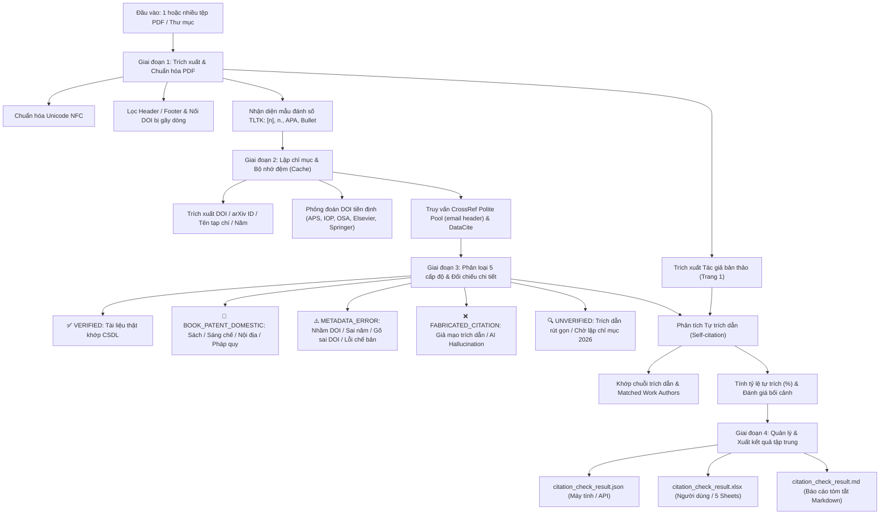

# PDF Citation Audit & Verification Skill

## 1. Tổng quan (Overview)

Kỹ năng này cung cấp quy trình chuẩn hóa và bộ công cụ tự động hóa toàn diện nhằm:
1. **Tiếp nhận linh hoạt**: Kiểm tra **một tệp PDF lẻ**, **nhiều tệp PDF cụ thể** hoặc **quét toàn bộ thư mục** chứa hàng loạt bản thảo.
2. **Trích xuất toàn vẹn danh mục tài liệu tham khảo (TLTK)** từ các bản thảo khoa học định dạng PDF (bài báo hội thảo, kỷ yếu, tạp chí khoa học, luận văn/luận án).
3. **Đối chiếu chéo tự động với các cơ sở dữ liệu học thuật quốc tế** (CrossRef Polite Pool, DataCite, Handle.net, arXiv API, Europe PMC) qua cơ chế bộ nhớ đệm bền vững (`persistent cache`).
4. **Phát hiện gian lận học thuật & Trích dẫn giả mạo (AI Hallucination)**: nhận diện trường hợp mô hình AI bịa đặt tên bài báo, tự gán mã DOI giả (`404 Not Found`) hoặc chiếm đoạt mã DOI của một bài báo thật hoàn toàn khác.
5. **Phát hiện lỗi siêu dữ liệu (Metadata Errors) & Lỗi chế bản**: chỉ ra trường hợp bài báo có thật nhưng tác giả dán nhầm DOI, gõ thừa/thiếu ký tự DOI, ghi sai năm xuất bản, hoặc dán lẫn văn bản thân bài/nhãn đồ thị vào mục TLTK.
6. **Phân tích Tự trích dẫn của Tác giả (Author Self-Citation Analysis)**: tự động trích xuất tên tác giả bài báo từ Trang 1, so khớp đa biến thể tên người Việt và quốc tế, phát hiện các tài liệu tự trích dẫn, tính tỷ lệ phần trăm (`self_citation_rate`) và phân loại bối cảnh (bài tổng quan nhóm nghiên cứu vs trích dẫn cục bộ quá mức).
7. **Quản lý kết quả tập trung, không phân mảnh thư mục**: Thay vì tạo từng thư mục riêng lẻ cho mỗi bài, toàn bộ kết quả được gom và xuất thành 2 tệp tập trung:
   - `citation_check_result.json`: Dữ liệu có cấu trúc phân tầng đầy đủ dành cho hệ thống máy tính, API và tích hợp tự động hóa.
   - `citation_check_result.xlsx`: Sổ tay Excel chuyên nghiệp gồm **5 trang tính (worksheets)** với giao diện trực quan, bảng màu chuẩn hóa, bộ lọc AutoFilter và cố định tiêu đề (Freeze Panes) phục vụ Ban biên tập và phản biện.

---

## 2. Khi nào sử dụng kỹ năng này (When to Use)

- Ban biên tập, hội đồng khoa học hoặc phản biện cần thẩm định tính trung thực của danh mục tài liệu tham khảo trong một hoặc nhiều bài báo, tập kỷ yếu hoặc luận văn.
- Kiểm tra nghi vấn tác giả sử dụng ChatGPT / LLM để sinh tài liệu tham khảo giả mạo (hallucinated references).
- Đánh giá mức độ tự trích dẫn (self-citation rate) của tác giả để phòng tránh thao túng trích dẫn (citation padding), đồng thời ghi nhận đúng đắn các bài báo tổng kết chặng đường nghiên cứu của nhóm (retrospective lab review).
- Quét hàng loạt (batch audit) từ 1 đến hàng trăm bản thảo PDF mà không bị chặn Rate Limit từ các API học thuật.
- Rà soát lỗi trích dẫn (nhầm DOI, sai năm, sai tạp chí) trước khi xuất bản bản thảo chính thức.

---

## 3. Kiến trúc quy trình 4 giai đoạn (4-Stage Pipeline)



---

## 4. Các quy tắc kỹ thuật trọng yếu (Key Technical Rules)

### 4.1. Trích xuất văn bản từ PDF & Nhận diện Tác giả
1. **Chuẩn hóa Unicode:** Tiếng Việt trong PDF thường lẫn lộn giữa Unicode Tổ hợp (NFD) và Dựng sẵn (NFC). Luôn dùng `unicodedata.normalize('NFC', text)` ngay sau khi lấy text từ `pymupdf` (`fitz`).
2. **Trích xuất tên tác giả từ Trang 1 (`extract_manuscript_authors`):**
   - Lọc bỏ dòng đầu (header hội nghị/tạp chí).
   - Bỏ qua tiêu đề bài viết (dựa vào từ khóa trong tên tệp PDF).
   - Lọc bỏ thông tin cơ quan/đơn vị (`khoa`, `viện`, `đại học`, `trường`, `phòng`, `email`, `@`).
   - Tước bỏ học hàm/học vị (`GS.`, `PGS.`, `TS.`, `ThS.`, `Prof.`, `Dr.`).
   - Xử lý các tác giả tập thể: ví dụ `Bộ môn Vật lý hạt nhân - Kỹ thuật hạt nhân`.
3. **Lọc số trang an toàn:** Chỉ xóa các dòng là chữ số `^\d{1,3}$` nếu dòng đó nằm ở đầu trang (2 dòng đầu) hoặc cuối trang (2 dòng cuối). **Không** xóa số nguyên trang ở giữa văn bản vì các mã DOI dài thường bị bẻ gãy dòng số ở giữa.
4. **Nối DOI bị gãy dòng:** Áp dụng regex nối liền các đoạn gãy như `10.\n1103/`, `doi.org/10.xxxx/\n12345`.

### 4.2. Chiến lược mạng & Chống nghẽn Rate Limit
1. **CrossRef Polite Pool:** Bắt buộc gửi tham số `mailto=your_email@domain.edu.vn` và User-Agent định danh rõ ràng. Điều này kích hoạt hàng đợi ưu tiên (Polite Pool) với tốc độ lên đến 10 req/s và hạn mức truy vấn ổn định.
2. **Khoảng cách truy vấn tìm kiếm (Search Throttle):** Duy trì độ trễ tối thiểu `0.25s - 0.28s` giữa các lượt gọi tìm kiếm văn bản `/works?query.bibliographic=...`.
3. **Persistent Cache (`api_cache.json`):** Mọi kết quả HTTP 200 (và HTTP 404 cho DOI) phải được ghi vào cache bền vững. Khi chạy kiểm tra lại hoặc tinh chỉnh quy tắc, 100% kết quả được nạp tức thì từ cache mà không tốn tài nguyên mạng hay thời gian chạy ngầm vô ích.

### 4.3. Thuật toán nhận diện Gian lận trích dẫn (AI Hallucination vs Metadata Error)
1. **Trích dẫn giả mạo (AI Hallucination - `FABRICATED_CITATION`):**
   - **Đặc điểm 1:** Mã DOI trong bản thảo trả về `404 Not Found` trên CrossRef + DataCite, đồng thời tìm kiếm theo tiêu đề bài báo cũng hoàn toàn không có trên bất kỳ CSDL nào.
   - **Đặc điểm 2 (Chiếm đoạt DOI):** Bản thảo ghi tên một bài báo khoa học, nhưng mã DOI gắn kèm thực tế thuộc về một bài báo hoàn toàn khác (khác tác giả, khác năm, khác lĩnh vực, khác tạp chí), đồng thời bài báo ghi trong bản thảo không có thật.
2. **Tài liệu thật nhưng dán nhầm DOI (`VERIFIED_WITH_METADATA_ERROR`):**
   - Mã DOI trong bản thảo trỏ tới bài báo khác, NHƯNG khi tìm kiếm tiêu đề bài báo ghi trong bản thảo thì **tìm thấy bài báo thật** trên CrossRef/Europe PMC với một mã DOI chính xác khác. (Đây là lỗi copy-paste nhầm lẫn của tác giả, không phải bịa đặt).
3. **Lỗi gõ thừa số 0 trong DOI:** Rút gọn chuỗi số 0 lặp lại để tìm thấy đúng bài báo trên nhà xuất bản gốc.

### 4.4. Thuật toán Phân tích Tự trích dẫn của Tác giả (Author Self-Citation Analysis)
1. **Xây dựng biến thể so khớp tác giả (`build_author_matchers`):**
   - So khớp linh hoạt: `[Họ] [Đệm] [Tên]`, `[Initial] [Tên]` (`P. D. Tam`), `[Tên], [Initial]` (`Tam, P. D.`), tên không dấu và đối chiếu đồng thời với danh sách tác giả `matched_work["authors"]` từ CSDL CrossRef.
2. **Tiêu chuẩn đánh giá:**
   - 🟢 **$\le 25\%$:** Tự trích dẫn ở mức bình thường, kế thừa tự nhiên các nghiên cứu trước đây.
   - ⚠️ **$25\% - 50\%$:** Cần xem xét sự cân đối với việc bao quát các tài liệu độc lập cùng chuyên ngành.
   - 🔄 **$> 50\%$:** Phân biệt rõ **Báo cáo tổng kết chặng đường 10–20 năm của nhóm nghiên cứu (Retrospective Lab Review)** (hợp lệ và mang giá trị lịch sử) với bài báo nghiên cứu độc lập thông thường (cần tránh trích dẫn cục bộ).

---

## 5. Hướng dẫn sử dụng chi tiết (Usage)

Bộ mã nguồn mẫu nằm tại: `C:\Users\MINHDOAN\.gemini\config\skills\pdf-citation-audit\scripts\`
- `extract_references.py`: Mô-đun trích xuất TLTK và tác giả bản thảo từ PDF.
- `verifier.py`: Bộ máy đối chiếu API, thuật toán phân loại và phân tích tự trích dẫn.
- `excel_reporter.py`: Bộ máy tạo tệp Excel `.xlsx` chuyên nghiệp gồm 5 sheets với màu sắc và bố cục chuẩn.
- `batch_audit.py`: Điểm điều phối trung tâm tiếp nhận đa đầu vào và xuất báo cáo tập trung.

### Lệnh chạy với các kịch bản đầu vào khác nhau:

#### Kịch bản 1: Quét toàn bộ thư mục chứa các bản thảo PDF
```bash
python -X utf8 "C:\Users\MINHDOAN\.gemini\config\skills\pdf-citation-audit\scripts\batch_audit.py" \
    "g:\My Drive\60_Bai_Bao_PDF_Tu_Tieu_Ban" \
    --email "your_email@vnu.edu.vn"
```

#### Kịch bản 2: Quét một bản thảo PDF duy nhất
```bash
python -X utf8 "C:\Users\MINHDOAN\.gemini\config\skills\pdf-citation-audit\scripts\batch_audit.py" \
    "path/to/paper.pdf" \
    --email "your_email@vnu.edu.vn"
```

#### Kịch bản 3: Quét nhiều bản thảo PDF cụ thể
```bash
python -X utf8 "C:\Users\MINHDOAN\.gemini\config\skills\pdf-citation-audit\scripts\batch_audit.py" \
    "paper1.pdf" "paper2.pdf" "paper3.pdf" \
    --output-dir "output_folder" \
    --email "your_email@vnu.edu.vn"
```

---

## 6. Cấu trúc tệp đầu ra tập trung (Output Structure)

Toàn bộ kết quả kiểm định được lưu tại thư mục đích gồm 2 tệp chính (và 1 tệp tóm tắt bổ trợ):

1. **`citation_check_result.json` (Dành cho máy tính / Tự động hóa):**
   - Lưu trữ toàn bộ dữ liệu có cấu trúc: thống kê tổng quan (`summary`), danh sách lỗi cảnh báo (`flagged_issues`), và mảng chi tiết từng bản thảo (`manuscripts`) gồm tác giả, số lượng, tỷ lệ tự trích dẫn và kết quả xác thực từng trích dẫn.

2. **`citation_check_result.xlsx` (Dành cho người dùng / Ban biên tập):**
   Gồm **5 trang tính (worksheets)** chuyên biệt:
   - **Sheet 1 (`Tổng quan & Thống kê`):** Bảng KPI tổng thể, bảng phân loại 5 trạng thái xác thực kèm màu sắc trực quan, bảng chuẩn mực đánh giá tỷ lệ tự trích dẫn.
   - **Sheet 2 (`Danh sách Bản thảo`):** Bảng danh mục toàn bộ các bài báo đã kiểm tra; cột thống kê số TLTK, tỷ lệ tự trích dẫn, số mục xác thực, lỗi metadata, số mục giả mạo AI và đánh giá sơ bộ.
   - **Sheet 3 (`Chi tiết Toàn bộ TLTK`):** Bảng dữ liệu phẳng của toàn bộ các tài liệu tham khảo từ tất cả các bài; đầy đủ mã bài, trích dẫn gốc, đánh dấu tự trích, trạng thái CSDL, mã DOI chuẩn và ghi chú đối chiếu.
   - **Sheet 4 (`Cảnh báo & Lỗi cần xử lý`):** Bộ lọc danh sách các trích dẫn giả mạo (AI hallucination) và các lỗi metadata (sai năm, nhầm DOI, dán lẫn thân bài) kèm hướng khắc phục cụ thể để gửi cho tác giả.
   - **Sheet 5 (`Phân tích Tự trích dẫn`):** Danh mục riêng tất cả các mục tự trích dẫn của các tác giả phục vụ rà soát tính minh bạch học thuật.

3. **`citation_check_result.md` (Báo cáo Markdown tóm tắt):**
   - Báo cáo tổng hợp nhanh định dạng Markdown hiển thị tốt trên GitHub, VSCode và các công cụ xem tài liệu.
